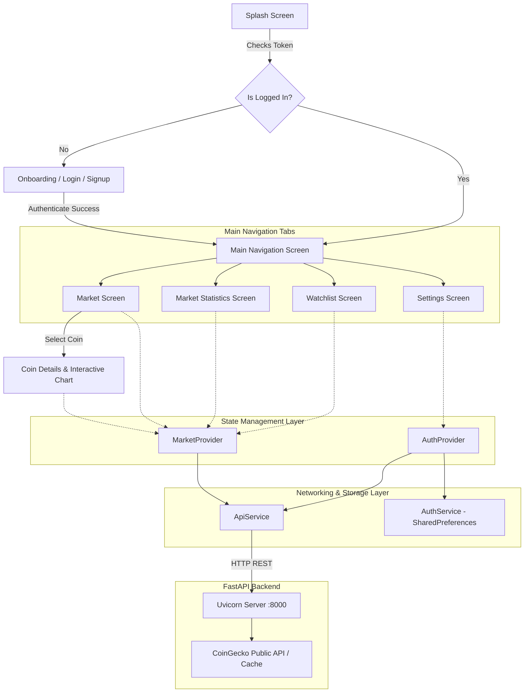

# ⚡ Crypto Research App

[](https://flutter.dev)
[](https://dart.dev)
[](https://fastapi.tiangolo.com)
[](https://www.python.org)
[](https://opensource.org/licenses/MIT)
[](https://m3.material.io)

A high-performance, real-time cryptocurrency research and portfolio tracking mobile application. Built with **Flutter** and **Provider** state management, featuring a custom **FastAPI** backend with live **CoinGecko** market data, JWT authentication, interactive financial charts, and an offline-first architecture.

---

## 🌟 Key Features

- **🌙 Premium Cyberpunk Dark UI**: Designed with deep obsidian surfaces (`#121212`), elevated card layers (`#1E1E1E`), and electric neon-lime accents (`#B4DE01`).
- **📊 Interactive Financial Charts**: Touch-responsive historical price graphs with custom tooltips, gradient area fills, and selectable timeframes (**7D, 14D, 30D, 90D, 1Y**), accompanied by smooth micro sparklines.
- **⚡ Live Market Intelligence**: Real-time prices, 24h price percentage changes, market capitalization rankings, 24h trading volume, and global Bitcoin/Ethereum market dominance metrics.
- **⭐ Personalized Watchlist**: Instant add/remove favorites with real-time UI synchronization and backend persistence.
- **🔍 Instant Search & Multi-criteria Filtering**: Instant ticker search (e.g., `BTC`, `ETH`, `SOL`) and sort filters (Top Gainers, Top Losers, Highest Price, Market Cap).
- **🔐 Secure Authentication System**: User registration, login, profile updates, and JWT session persistence backed by `SharedPreferences`.
- **🛡️ Offline-First & Resilient Architecture**: Automatic fallback to local cached data whenever the network is disconnected or the upstream CoinGecko API rate-limits, guaranteeing zero crashes.
- **📝 Clean Developer Logging**: Human-readable, structured console logging for API requests, responses, and state changes.

---

## 📱 Application Flow & Architecture



---

## 📂 Project Directory Structure

```text
crypto_research_app/
├── lib/
│   ├── main.dart                          # App entry point, system UI overlay, MultiProvider setup
│   ├── core/
│   │   ├── constants/
│   │   │   └── app_constants.dart         # Base URLs, API endpoints, mock data fallbacks
│   │   ├── theme/
│   │   │   └── app_theme.dart             # Material 3 dark palette, typography, custom colors
│   │   └── utils/
│   │       └── formatters.dart            # Currency ($), percentage (%), and volume formatting
│   ├── models/
│   │   ├── coin_model.dart                # CryptoCoin model & PricePoint chart data
│   │   ├── market_stats_model.dart        # Global market cap, volume, and dominance metrics
│   │   └── user_model.dart                # User profile data model
│   ├── providers/
│   │   ├── auth_provider.dart             # Login, register, profile update & session state
│   │   └── market_provider.dart           # Coin list, watchlist, search, market stats state
│   ├── screens/
│   │   ├── splash_screen.dart             # Animated logo & session router
│   │   ├── onboarding_screen.dart         # Introductory carousel & get-started actions
│   │   ├── login_screen.dart              # User login & social auth hooks
│   │   ├── signup_screen.dart             # User registration
│   │   ├── main_navigation_screen.dart    # Bottom navigation bar host
│   │   ├── market_screen.dart             # All coins list, search bar, sort & filter
│   │   ├── market_statistics_screen.dart  # Global stats, dominance bars, market insights
│   │   ├── watchlist_screen.dart          # Saved favorites view
│   │   ├── coin_details_screen.dart       # Detailed statistics & interactive price chart
│   │   ├── settings_screen.dart           # User profile, app settings & policies
│   │   └── policy_viewer_screen.dart      # Terms of service and privacy policy viewer
│   ├── services/
│   │   ├── api_service.dart               # HTTP client with request/response logging
│   │   └── auth_service.dart              # Token & session persistence in SharedPreferences
│   └── widgets/
│       ├── interactive_chart.dart         # Custom interactive graph with touch tooltips
│       ├── sparkline_chart.dart           # Lightweight mini sparkline curves
│       └── empty_state_view.dart          # Reusable fallback illustration & retry button
├── assets/                                # App logo, social icons & branding images
├── test/
│   └── widget_test.dart                   # Automated widget integration tests
└── pubspec.yaml                           # Flutter dependencies & assets configuration
```

---

## 🚀 Getting Started

### 1. Prerequisites
- **Flutter SDK**: `^3.11.5` or later ([Install Flutter](https://docs.flutter.dev/get-started/install))
- **Python**: `3.10+` ([Download Python](https://www.python.org/downloads/))
- **Git**: Installed and configured

---

### 2. Backend Setup (FastAPI)

1. Open your terminal and navigate to the backend directory:
   ```bash
   cd crypto_backend
   ```

2. Create and activate a Python virtual environment:
   ```bash
   # Windows (PowerShell)
   python -m venv .venv
   .\.venv\Scripts\Activate.ps1

   # macOS / Linux
   python3 -m venv .venv
   source .venv/bin/activate
   ```

3. Install requirements:
   ```bash
   pip install -r requirements.txt
   ```

4. Start the FastAPI development server:
   ```bash
   uvicorn app.main:app --host 0.0.0.0 --port 8000 --reload
   ```
   > 💡 The backend documentation will be accessible at: `http://localhost:8000/docs`

---

### 3. Frontend Setup (Flutter)

1. Open a new terminal and navigate to the Flutter project:
   ```bash
   cd crypto_research_app
   ```

2. Configure the Backend IP:
   Open `lib/core/constants/app_constants.dart` and update the IP address to match your machine's local IP (e.g. `192.168.x.x` or your mobile hotspot IP):
   ```dart
   static const String _defaultHost = '10.243.159.82'; // Replace with your computer's local IP
   static const int _defaultPort = 8000;
   ```

3. Install Flutter packages:
   ```bash
   flutter pub get
   ```

4. Run static analysis & tests:
   ```bash
   flutter analyze
   flutter test
   ```

5. Launch the application on your connected device or emulator:
   ```bash
   flutter run
   ```

---

## 📡 REST API Reference

The app communicates with the FastAPI backend through the following endpoints:

| Method | Endpoint | Description | Auth Required |
|:---|:---|:---|:---:|
| `GET` | `/api/health` | Service health status check | ❌ |
| `POST` | `/api/auth/register` | Register a new user | ❌ |
| `POST` | `/api/auth/login` | Login user & receive JWT token | ❌ |
| `GET` | `/api/auth/me` | Fetch authenticated user profile | ✅ |
| `PUT` | `/api/auth/profile` | Update profile information | ✅ |
| `GET` | `/api/coins` | Paginated live cryptocurrency list | ❌ |
| `GET` | `/api/coins/{id}` | Full coin profile & metrics | ❌ |
| `GET` | `/api/coins/{id}/chart?days={n}` | Historical chart price points | ❌ |
| `GET` | `/api/coins/search?query={q}` | Coin search by ticker or name | ❌ |
| `GET` | `/api/market/stats` | Global market cap, volume & dominance | ❌ |
| `GET` | `/api/watchlist` | Get current user's saved watchlist | ✅ |
| `POST` | `/api/watchlist` | Add a coin to user's watchlist | ✅ |
| `DELETE`| `/api/watchlist/{id}` | Remove a coin from watchlist | ✅ |

---

## 🎨 Design System

| Element | Specification | Hex / Value |
|:---|:---|:---|
| **Background** | Deep Onyx | `#121212` |
| **Surface / Nav** | Elevated Charcoal | `#1E1E1E` |
| **Card Surface** | Highlight Grey | `#282828` |
| **Primary Accent** | Electric Neon Lime | `#B4DE01` |
| **Bullish Indicator** | Profit Green | `#B4DE01` |
| **Bearish Indicator** | Loss Red | `#FF3B56` |
| **Primary Text** | Pure White | `#FFFFFF` |
| **Secondary Text** | Soft Gray | `#A8A8A8` |

---

## 🧪 Testing

The repository contains automated unit and widget integration tests:

```bash
flutter test
```

All test suites verify:
- Navigation routing from `SplashScreen` to `OnboardingScreen` or `MainNavigationScreen`.
- Token-based automatic session restoration.
- Graceful error handling when backend is unreachable.

---

## 📄 License

This project is licensed under the **MIT License** — feel free to use and adapt it for your own personal or commercial cryptocurrency projects.
